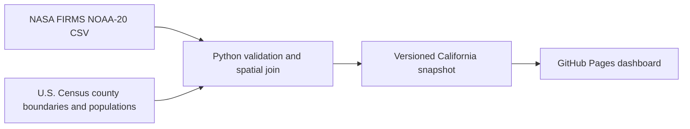

# CrisisTwin — California Wildfire Monitor

**[Open the live dashboard](https://mykeil-tzul.github.io/crisistwin-disaster/)**

I built CrisisTwin to make satellite fire data easier to explore. Open the map, pick a county, and see where NOAA-20 picked up heat in the last 24 hours, 48 hours, or seven days. The field brief summarizes the selected readings in plain language. You can switch to satellite imagery, click a detection for details, and download the readings behind the current view.

## What the numbers mean

A dot represents a heat detection. It can come from wildfire, agricultural burning, or another source of heat. Multiple satellite passes can pick up the same location. Clouds, smoke, and the timing of a satellite pass can affect what gets detected.

County population estimates show how many people live in a selected county. Estimating actual exposure would require a confirmed fire perimeter and finer population geography. For confirmed incident details and evacuation information, use [CAL FIRE](https://www.fire.ca.gov/incidents) and local officials.

## How it works



1. GitHub Actions fetches NASA's rolling seven-day feed hourly. The pipeline retries temporary network errors and checks the file format, observation timestamps, and coordinate ranges.
2. A spatial index matches the readings to California county polygons. Duplicate readings are dropped. When a refresh fails validation, the last good snapshot stays available.
3. The map, timeline, county rankings, and brief use the same filters. The page shows the last successful retrieval and the newest observation in the U.S. source feed separately. The brief is generated by rules from the selected counts.
4. GitHub Pages serves the app and its data without asking visitors for an account or an API key.

| What I check | Where to see it |
| --- | --- |
| Geographic coverage | 58 California county boundaries and NOAA-20 VIIRS detections |
| Refresh timing | Feed check and source observation timestamps in the dashboard |
| Pipeline reliability | Refresh status, warnings, and test results in GitHub Actions |
| Processing time | Pipeline seconds in the published snapshot and refresh log |
| Location validation | Coordinate checks and point-in-polygon tests. These verify the join and input bounds. |

## Run it locally

Run these commands from the repository root.

```bash
python -m pip install -r requirements.txt
python -m unittest discover -s tests
python scripts/refresh.py
python -m http.server 8000 --directory site
```

Open `http://localhost:8000`. The checked-in snapshot allows the site to load data before a local refresh. Map tiles and fonts load from their respective providers.

To rebuild the geography, download the [2024 Census county boundary archive](https://www2.census.gov/geo/tiger/GENZ2024/shp/cb_2024_us_county_500k.zip) and [2025 Census county population estimates](https://www2.census.gov/programs-surveys/popest/datasets/2020-2025/counties/totals/co-est2025-alldata.csv), then run `python scripts/build_counties.py <county-zip> <population-csv>`.

Satellite data from [NASA FIRMS](https://firms.modaps.eosdis.nasa.gov/usfs/active_fire/). Boundaries and population from the [U.S. Census Bureau](https://www.census.gov/programs-surveys/popest.html). Leaflet powers the map with CARTO/OpenStreetMap and Esri basemaps.
